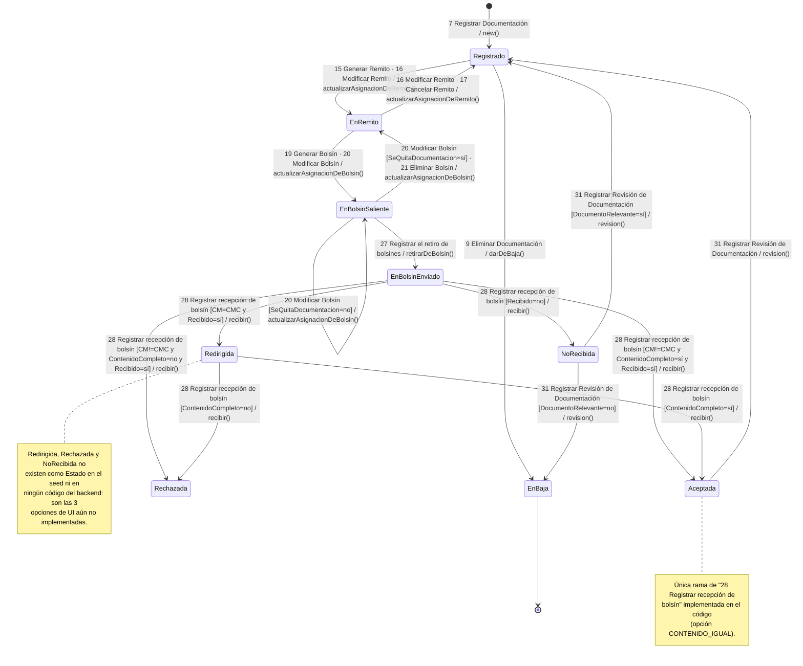
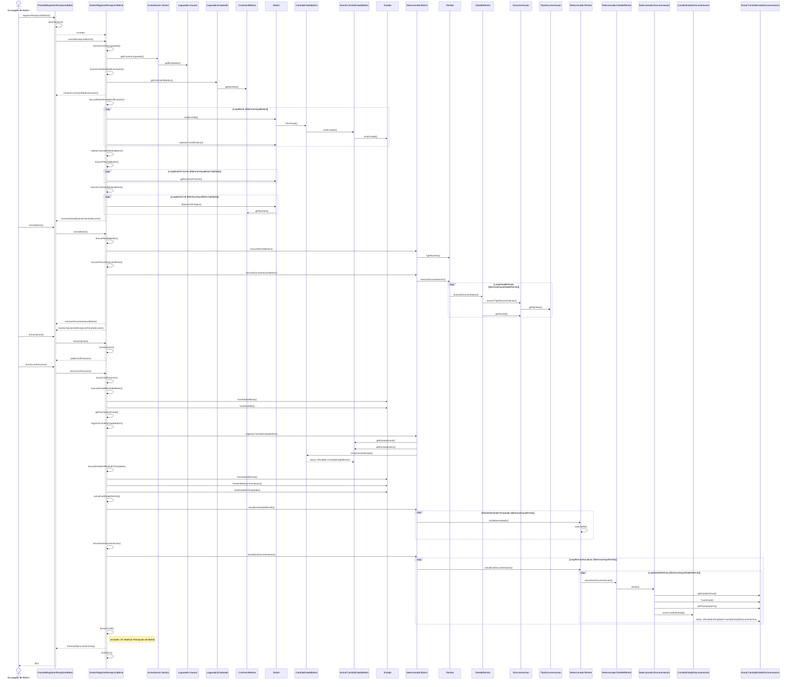

# TP_BOLSIN_DS

Registrar recepción de bolsín — implementación web del flujo normal del CU 28, construida a partir del diagrama
de clases, el diagrama de secuencia, la máquina de estados y la plantilla
funcional suministrados (Entrega 1, PPAI 2026, Grupo 6).

## Tecnologías

- Lenguaje: TypeScript.
- Backend: NestJS.
- Persistencia: Prisma ORM con SQLite.
- Frontend: Angular standalone.
- Tecnología: Web.

Las clases `PantallaRegistrarRecepcionBolsin` (Boundary),
`GestorRegistrarRecepcionBolsin` (Control) y las entidades del dominio conservan
los nombres y responsabilidades del modelo. Los identificadores, DTO, controlador
HTTP y adaptador de API son elementos técnicos necesarios para implementarlo como
aplicación web.

## Modelo de dominio

El agregado central es **Bolsin**, que delega en cascada según el diagrama de
clases del análisis: `Bolsin -> Remito -> DetalleRemito -> Documentacion`. Cada
entidad que tiene ciclo de vida propio (Bolsin, Documentacion) lo expresa como
una lista de cambios de estado con fecha de inicio/fin (`CambioEstadoBolsin`,
`CambioEstadoDocumentacion`), nunca como un campo de estado mutable suelto — el
estado "actual" es siempre el cambio cuyo `fechaHoraFin` es `null`
(`sosActual()`). `Estado` es un catálogo único (`Nombre` + `Ambito`) compartido
por Bolsin, Remito y Documentacion, consultado mediante predicados de dominio
(`sosEnviado()`, `sosRecibido()`, `sosAmbitoBolsin()`, etc.) en vez de comparar
strings sueltos fuera de la entidad — es el patrón Expert del diagrama aplicado
literalmente.

`Empleado`, `ComisionMedica`, `Sesion` y `Usuario` son transversales: cualquier
caso de uso futuro los necesita para saber quién está logueado y a qué comisión
pertenece, por eso viven en el kernel compartido (`shared/`, ver more abajo) y
no dentro del módulo de un único CU.

```mermaid
classDiagram
    class PantallaRegistrarRecepcionBolsin {
        <<Boundary>>
        +registrarRecepcionBolsin()
        +abrirVentana()
        +mostrarComisionMedicaUsuario()
        +mostrarDatosBolsinesParaSeleccion()
        +tomarBolsin()
        +mostrarDocumentacionBolsin()
        +mostrarOpcionesRecepcionParaSeleccion()
        +tomarOpcion()
        +pedirConfirmacion()
        +tomarConfirmacion()
        +informarEjecucionExitosa()
    }
    class GestorRegistrarRecepcionBolsin {
        <<Control>>
        +nuevaRecepcionBolsin()
        +buscarUsuarioLogueado()
        +buscarComisionMedicaUsuario()
        +buscarBolsinEnviadoCMUsuario()
        +validarComisionMedicaBolsin()
        +buscarPrecintoBolsin()
        +buscarComisionMedicaBolsin()
        +tomarBolsin()
        +buscarRemitoBolsin()
        +buscarDocumentacionBolsin()
        +tomarOpcion()
        +tomarConfirmacion()
        +buscarEstadoRecibidoBolsin()
        +getFechaHoraActual()
        +registrarCambioEstadoBolsin()
        +buscarEstadoRecibidoYAceptado()
        +actualizarEstadoRemito()
        +actualizarDocumentacion()
        +llamarCU29()
        +finDelCU()
    }
    class Sesion { +getUsuarioLogueado() }
    class Usuario { +getEmpleado() }
    class Empleado {
        +apellido
        +email
        +getComisionMedica()
    }
    class ComisionMedica {
        +nombre
        +getNombre()
    }
    class Estado {
        +nombre
        +ambito
        +sosEnviado()
        +sosRecibido()
        +sosRecibidoYAceptado()
        +sosAmbitoBolsin()
        +sosAmbitoRemito()
        +sosAmbitoDocumentacion()
    }
    class Bolsin {
        +numeroPrecinto
        +sosEnviado()
        +obtenerTuCMDestino()
        +obtenerCMOrigen()
        +getNumeroPrecinto()
        +buscarRemitoBolsin()
        +buscarDocumentacionBolsin()
        +registrarCambioEstadoBolsin()
        +actualizarEstadoRemito()
        +actualizarDocumentacion()
        +getEstadoActual()
        +crearCambioEstado()
    }
    class CambioEstadoBolsin {
        +fechaHoraInicio
        +fechaHoraFin
        +sosActual()
        +sosEnviado()
        +setFechaHoraFin()
    }
    class Remito {
        +numero
        +getNumero()
        +buscarDocumentacion()
        +actualizarDocumentacion()
        +recibidoAceptado()
        +setEstado()
    }
    class DetalleRemito {
        +buscarDocumentacion()
        +actualizarDocumentacion()
    }
    class Documentacion {
        +asunto
        +getAsunto()
        +mostrarTipoDocumentacion()
        +recibir()
        +getEstadoActual()
        +crearCambioEstado()
        +revision()
        +darDeBaja()
        +actualizarAsignacionDeRemito()
        +actualizarAsignacionDeBolsin()
        +retirarDeBolsin()
    }
    class TipoDocumentacion { +nombre +getNombre() }
    class CambioEstadoDocumentacion {
        +fechaHoraInicio
        +fechaHoraFin
        +sosActual()
        +setFechaHoraFin()
    }

    PantallaRegistrarRecepcionBolsin ..> GestorRegistrarRecepcionBolsin : crea
    GestorRegistrarRecepcionBolsin ..> Sesion : consulta
    Sesion "1" --> "1" Usuario
    Usuario "1" --> "1" Empleado
    Empleado "1" --> "1" ComisionMedica : AsignadoA
    ComisionMedica "1" --> "*" Bolsin : origen / destino
    ComisionMedica "1" --> "*" Remito : origen / destino
    ComisionMedica "1" --> "*" Documentacion : CMorigen
    Bolsin "1" --> "1..*" Remito
    Bolsin "1" --> "1..*" CambioEstadoBolsin : CEBolsin
    Remito "1" --> "1..*" DetalleRemito
    DetalleRemito "1..*" --> "1" Documentacion
    Documentacion "1" --> "1" TipoDocumentacion
    Documentacion "1" --> "1..*" CambioEstadoDocumentacion : CEDocumentacion
    CambioEstadoBolsin "*" --> "1" Estado
    CambioEstadoDocumentacion "*" --> "1" Estado
    Remito "*" --> "1" Estado
    CambioEstadoBolsin "*" --> "1" Empleado : ResponsableCE
    CambioEstadoDocumentacion "*" --> "1" Empleado : ResponsableCE
```



> Reconstruido a partir de `DiagramaClasesAnalisis.png` (la vista curada y
> entregada) y verificado contra `DiagramaClasesVistaEstaticaPPAI.mdj`, el
> modelo StarUML completo. El `.mdj` es más amplio que lo entregado: incluye
> clases y atributos de otros trabajos/vistas no usados en este CU
> (`Provincia`, `Localidad`, `Rol`, `Archivo`, superclases genéricas `Pantalla`/
> `Gestor`) y algunos atributos duplicados por ediciones sucesivas
> (`numeroPrecinto` repetido, `SosActual`/`sosActual` como variantes). El
> diagrama de arriba usa la vista curada (PNG), que es la que coincide
> método a método con el código.

## Máquina de estados de `Documentacion`



Esta máquina explica por qué el frontend ofrece 4 "opciones de recepción"
(`recepcion-bolsin.component.ts`) pero el backend solo acepta una
(`opcion-recepcion.handlers.ts`, `manejador-opcion-recepcion.ts`): las otras 3
se corresponden con las ramas guardadas de `Recibir()` hacia `Redirigida`,
`Rechazada` y `NoRecibida`, que nunca llegaron a implementarse — ver
[Limitaciones conocidas](#limitaciones-conocidas--fuera-de-alcance).

## Caso de uso CU28 — diagrama de secuencia (flujo normal)



> Transcripto desde `DiagramaSecuencia_G6.png`, el export visual de
> `DiagramaSecuenciaPPAI.eapx`. El `.eapx` es una base Microsoft Access
> (formato propietario de Enterprise Architect) y no se puede leer como texto;
> este Mermaid es una reconstrucción fiel leyendo la imagen exportada, no un
> parseo del binario.

## Arquitectura del backend

El backend está organizado como **monolito modular** con **arquitectura hexagonal**
(puertos y adaptadores) por módulo:

La división de primer nivel es por **subdominio del negocio**, no por tipo de
archivo: lo primero que se lee son los nombres del dominio, no los del
framework. Lo puramente técnico vive aparte, en `platform/`, y no finge ser un
subdominio.

```
backend/src/
├── arquitectura.spec.ts        # test que hace fallar el build si se viola la regla
├── platform/                   # base técnica, NO es un subdominio
│   └── persistence/prisma/     # PrismaModule y PrismaService
└── modules/
    ├── recepcion-bolsin/       # subdominio principal (CU28)
    │   ├── index.ts            # API pública: solo expone el módulo Nest
    │   ├── domain/             # Bolsin, Remito, DetalleRemito, Documentacion, ...
    │   ├── application/
    │   │   ├── ports/
    │   │   │   ├── in/         # puerto de entrada: IRegistrarRecepcionBolsin
    │   │   │   └── out/        # IBolsinRepository, IUnidadDeTrabajo, INotificadorRecepcion
    │   │   ├── dto/            # contratos de entrada/salida del caso de uso
    │   │   ├── errors/         # errores propios, sin semántica HTTP
    │   │   └── services/       # Gestor (implementa el puerto de entrada) y manejadores
    │   ├── infrastructure/
    │   │   ├── http/           # controlador REST y filtro de errores
    │   │   ├── notificaciones/ # adaptador del <<include>> al CU29
    │   │   └── persistence/    # adaptadores de salida, mapper y registros
    │   └── recepcion-bolsin.module.ts
    ├── identidad/              # subdominio de soporte: quién está logueado
    │   ├── index.ts            # API pública: Sesion, Usuario, Empleado, puerto y módulo
    │   ├── domain/ application/ infrastructure/
    │   └── identidad.module.ts
    ├── catalogo/               # subdominio de soporte: catálogo de Estado
    │   ├── index.ts
    │   ├── domain/ application/ infrastructure/
    │   └── catalogo.module.ts
    └── organizacion/           # kernel compartido: ComisionMedica
        ├── index.ts
        └── domain/
```

Cada subdominio expone una **API pública** (`index.ts`) y los demás solo pueden
importar desde ahí: alcanzar un archivo interno de otro módulo está prohibido y
verificado. Eso es lo que separa un monolito modular de una bola de barro con
carpetas.

`organizacion` es un kernel compartido a propósito: `ComisionMedica` es el mismo
concepto para identidad (a qué comisión pertenece un empleado) y para recepción
de bolsín (origen y destino). Lo que **no** se comparte es la representación
persistente: cada módulo define su propio `ComisionMedicaRegistro`, porque las
filas son un detalle de cada contexto.

Las tres propiedades que hacen que esto sea hexagonal y no solo carpetas con
nombres lindos:

1. **La regla de dependencia se cumple y es ejecutable.** `domain/` no importa
   nada de `application/` ni de `infrastructure/`, y `application/` no importa
   nada de `infrastructure/`. No es una promesa del README: lo verifica
   `src/arquitectura.spec.ts` en cada `npm test`, y falla nombrando el import
   culpable.
2. **Los puertos hablan en lenguaje de dominio.** `IBolsinRepository` recibe y
   devuelve `Bolsin`, `Estado`, `Empleado` — nunca filas ni tipos de Prisma.
   Reconstruir el agregado es tarea del adaptador (`BolsinMapper`, que por eso
   vive en `infrastructure/persistence/`). Los `*Registro` existen, pero solo
   los ve infraestructura.
3. **Hay puerto de entrada, no solo de salida.** El controlador HTTP depende de
   `IRegistrarRecepcionBolsin`, no de `GestorRegistrarRecepcionBolsin`. Exponer
   el CU por otro transporte (CLI, cola) no toca la capa de aplicación.
4. **El núcleo no depende de ningún framework.** Ni `domain/` ni `application/`
   importan NestJS o Prisma — también lo verifica el test. El gestor no tiene
   decoradores (se construye por fábrica en el módulo, que es el composition
   root) y lanza errores propios (`EntidadNoEncontradaError`,
   `OperacionInvalidaError`) en vez de `NotFoundException`/`BadRequestException`:
   traducirlos a 404 o 400 es tarea de `ErroresRecepcionBolsinFilter`, en el
   adaptador HTTP. Antes había 15 excepciones HTTP dentro del caso de uso, o
   sea semántica de transporte incrustada en el núcleo.

La atomicidad se resuelve con el puerto `IUnidadDeTrabajo`: el gestor pide
"ejecutá esto de forma atómica" y recibe repositorios ya ligados a la
transacción, con las mismas interfaces de siempre. Antes un `tx: unknown`
atravesaba 22 firmas —el tipo estaba escondido, pero el concepto de transacción
igual filtraba a la aplicación—; hoy no queda ninguno.

Tokens de inyección (DIP) y quién los provee:

| Token | Interfaz | Implementación | Declarado en |
|---|---|---|---|
| `REGISTRAR_RECEPCION_BOLSIN` | `IRegistrarRecepcionBolsin` (puerto de entrada) | `GestorRegistrarRecepcionBolsin` | `modules/recepcion-bolsin/recepcion-bolsin.module.ts` |
| `BOLSIN_REPOSITORY` | `IBolsinRepository` | `PrismaBolsinRepository` | `modules/recepcion-bolsin/recepcion-bolsin.module.ts` |
| `UNIDAD_DE_TRABAJO` | `IUnidadDeTrabajo` | `PrismaUnidadDeTrabajo` | `modules/recepcion-bolsin/recepcion-bolsin.module.ts` |
| `NOTIFICADOR_RECEPCION` | `INotificadorRecepcion` | `NotificadorCU29Log` | `modules/recepcion-bolsin/recepcion-bolsin.module.ts` |
| `ESTADO_REPOSITORY` | `IEstadoRepository` | `PrismaEstadoRepository` | `modules/catalogo/catalogo.module.ts` |
| `SESION_REPOSITORY` | `ISesionRepository` | `PrismaSesionRepository` | `modules/identidad/identidad.module.ts` |

Los adaptadores de persistencia reciben el cliente Prisma por constructor (no
por inyección de campo) y por eso se registran con `useFactory`: es lo que
permite que la unidad de trabajo cree instancias equivalentes ligadas a una
transacción abierta.

`PrismaModule` **no** es `@Global()`, a propósito: en un monolito modular los
límites entre módulos se declaran, no se perforan. Quien necesite
`PrismaService` importa `PrismaModule` desde `platform/`.

`backend/prisma/` (`schema.prisma`, `migrations/`, `seed.ts`) es la carpeta que
exige la CLI de Prisma en la raíz del proyecto backend y no se movió — no debe
confundirse con `backend/src/platform/persistence/prisma/`, que es el módulo de
NestJS que envuelve al cliente generado.

## Cómo se hace cumplir la arquitectura

Las reglas no viven en la buena voluntad de quien programa: fallan solas, y en
dos lugares complementarios.

**ESLint** (`eslint.config.mjs`, en la raíz del monorepo) tiene las reglas de
**capa**, que son las que conviene ver subrayadas en el editor mientras
escribís:

- `**/domain/**` no puede importar `application/`, `infrastructure/`, NestJS ni
  Prisma.
- `**/application/**` no puede importar `infrastructure/`, NestJS ni Prisma.

Cada una falla con un mensaje que explica qué hacer en su lugar (por ejemplo,
"definí un puerto" o "usá errores propios en vez de excepciones HTTP").

**El test de arquitectura** (`backend/src/arquitectura.spec.ts`) tiene las
reglas de **módulo**, que necesitan resolver rutas relativas y escalan solas
cuando se agrega un subdominio:

- ningún módulo alcanza el interior de otro (solo se puede importar su
  `index.ts`);
- cada módulo expone su API pública;
- más las reglas de capa, por si alguien desactiva ESLint.

```bash
npm run lint       # reglas de capa + calidad, en todo el monorepo
npm test           # incluye el test de arquitectura
```

Ambas corren en CI (`.github/workflows/ci.yml`) en cada push a `main` y en cada
pull request, junto con el build y los tests e2e.

## Trazabilidad: hallazgos de coherencia entre diagramas y código

Comparar los tres diagramas de análisis contra la implementación (más allá de
que los nombres de clases/métodos coincidan) sacó a la luz varios puntos donde
el código se apartaba de lo modelado. La mayoría ya están corregidos.

**Vigente:**

1. **La máquina de estados explica el alcance real de las "opciones" de
   recepción.** Ver la sección anterior: solo la rama que termina en
   `Aceptada` tiene representación en el backend (`seed.ts` solo crea los
   estados `EnBolsinEnviado` y `Aceptada` para `DOCUMENTACION`); `Redirigida`,
   `Rechazada` y `NoRecibida` no existen en ningún lado del código.

2. **La escritura se hace en dos pasos.** El gestor aplica la regla en el
   agregado (`bolsin.registrarCambioEstadoBolsin(...)`) y después le pide al
   puerto que lo persista. Lo más puro sería un `guardar(bolsin)` que derive
   los cambios del propio agregado, pero eso exige getters (`getCambiosEstado()`,
   `getEstado()`) que **no están en el diagrama de clases**. Se priorizó la
   fidelidad al modelo de análisis, que es lo que evalúa la cátedra: los
   comandos del puerto reciben entidades de dominio, no ids sueltos, así que
   el acoplamiento a persistencia sigue siendo nulo.

**Corregidos:**

- `nuevaRecepcionBolsin()` antes esquivaba el dominio: filtraba por SQL y
  devolvía campos crudos del registro Prisma, dejando `buscarPrecintoBolsin()`
  y `buscarComisionMedicaBolsin()` como código muerto. Hoy el puerto devuelve
  `Bolsin[]` y el gestor usa los tres métodos —`sosEnviado()`,
  `getNumeroPrecinto()`, `obtenerCMOrigen()`— igual que los loops
  `LoopBolsin` / `LoopBolsinPrecinto` / `LoopBolsinCM` de la secuencia.
- `buscarUsuarioLogueado()` navega `Sesion -> Usuario -> Empleado` con los
  mensajes del diagrama, porque el puerto devuelve el agregado `Sesion`. Antes
  recibía una fila ya aplanada y las clases `Sesion` y `Usuario` estaban
  muertas.
- `buscarEstadoAceptadaDocumentacion()` no validaba el estado traído con
  predicados de dominio, a diferencia de sus métodos hermanos. Hoy valida con
  `sosAmbitoDocumentacion()` y `sosAceptada()` (predicado agregado a `Estado`
  para cerrar esa asimetría).

## Limitaciones conocidas / fuera de alcance

- Solo se implementó la opción **"El contenido del bolsín es igual al
  registrado"** (`CONTENIDO_IGUAL`). Las otras 3 opciones
  (`FALTA_DOCUMENTACION`, `DOCUMENTACION_NO_CORRESPONDE`,
  `REDIRIGIR_OTRA_AREA`) están declaradas en `MANEJADORES_OPCION_RECEPCION`
  con `implementado: false`, y el gestor las rechaza con 400.
  La pantalla **muestra las cuatro situaciones del análisis** (para no perder
  trazabilidad con la plantilla funcional) pero las no implementadas se
  renderizan deshabilitadas y con la etiqueta "No implementado": no se pueden
  seleccionar ni confirmar. El catálogo lo publica el backend en
  `GET /recepciones-bolsines/:id` (campo `opciones`, con `codigo`,
  `descripcion` e `implementado`), de modo que `MANEJADORES_OPCION_RECEPCION`
  es la única fuente de verdad y la UI no puede desincronizarse: implementar
  una opción nueva es cambiar `implementado: true` en esa tabla.
- **CU29** ("Notificar Recepción de Bolsín") no está modelado en esta entrega.
  El `<<include>>` del diagrama de secuencia sí está materializado como puerto
  de salida (`INotificadorRecepcion`): hoy lo implementa `NotificadorCU29Log`,
  que solo deja constancia en el log. Cuando el CU29 exista se reemplaza ese
  adaptador sin tocar el gestor.
- **Las opciones de recepción todavía no son un Strategy.**
  `MANEJADORES_OPCION_RECEPCION` describe las situaciones y marca cuáles están
  implementadas, pero `ManejadorOpcionRecepcion` no tiene comportamiento y
  `tomarConfirmacion()` tiene un único flujo fijo. Al implementar los flujos
  alternativos A1–A6, cada entrada debería ganar su propio `ejecutar(...)` y el
  gestor delegar en él; si no, va a aparecer el `if/else` que esa tabla
  pretende evitar.
- Los flujos alternativos A1–A6 de la plantilla funcional (asociados a las 3
  opciones no implementadas y a sus transiciones de estado) quedan fuera de
  alcance.
- No hay autenticación: `sesionId` viaja como parámetro y el frontend lo fija
  en `1`. La URL del backend también está fija en el service de Angular.
- El listado inicial reconstruye el agregado completo de cada bolsín para que
  el dominio pueda responder `sosEnviado()` y `obtenerCMOrigen()`. Es una
  consulta más pesada que traer solo las columnas de la grilla; con el volumen
  del TP es irrelevante, y a cambio el dominio deja de ser decorativo. Si
  alguna vez pesa, la salida hexagonal es un puerto de consulta aparte
  (read model) en la capa de aplicación, no volver a filtrar en el gestor.

## Fuente de los diagramas

Los tres PNG y los archivos de modelado (`DiagramaClasesVistaEstaticaPPAI.mdj`
de StarUML, `DiagramaSecuenciaPPAI.eapx` de Enterprise Architect) están en la
carpeta de Drive de la Entrega 1 del grupo. Los diagramas Mermaid de este
README son reconstrucciones fieles hechas a partir de esos archivos (el `.mdj`
se pudo parsear como JSON; el `.eapx`, al ser una base Access binaria, se leyó
desde su export en PNG) y sirven para no depender de abrir StarUML/Enterprise
Architect para entender el diseño.

## Ejecución

Requiere Node.js 20 o superior. Desde la raíz:

```bash
npm install
npm run db:migrate
npm run db:seed
```

Luego, para levantar backend y frontend juntos en una sola terminal:

```bash
npm run dev
```

También se puede levantar cada uno por separado, en terminales distintas:

```bash
npm run dev:backend
npm run dev:frontend
```

La interfaz queda disponible en `http://localhost:4200` y la API en
`http://localhost:3000/api`.

## Migraciones y semillas

```bash
npm run db:migrate
npm run db:seed
```

`db:migrate` aplica las migraciones de Prisma (`backend/prisma/migrations`),
incluyendo el pase de `numeroPrecinto` y `Numero` de remito a tipo numérico.
`db:seed` ejecuta `backend/prisma/seed.ts` y carga un escenario repetible:
sesión `1`, comisión médica de destino y tres de origen, y cinco bolsines
(`BOL-2026-001` a `BOL-2026-005`) cada uno con sus remitos y documentación
en estado `Enviado`/`EnBolsinEnviado`, listos para recibir desde la interfaz.
Los `upsert` evitan duplicar datos al volver a correr la semilla.

## Navegación

Al ingresar se muestra el **panel de control**, con el usuario logueado y las
opciones disponibles. Desde ahí se accede a:

- `/panel` — panel de control (pantalla inicial).
- `/recepcion-bolsin` — registrar recepción de bolsín, con opción de
  **cancelar** la recepción en curso y volver al panel.

## Verificación

```bash
npm run lint
npm run build
npm test
npm run test:e2e
```

Es exactamente lo que corre el CI. `npm test` corre, además de los tests del
frontend, el **test de arquitectura**
del backend (`backend/src/arquitectura.spec.ts`): verifica que el dominio no
dependa de aplicación ni de infraestructura, que la aplicación no dependa de
infraestructura, que ningún módulo alcance el interior de otro y que ni el
dominio ni la aplicación importen Prisma o NestJS. Si alguien rompe la regla de
dependencia, falla nombrando el import culpable.

La semilla utiliza la sesión `1` e incorpora un bolsín completo para probar la
selección y confirmación. Al finalizar, el bolsín queda `Recibido`, el remito
`RecibidoYAceptado` y la documentación `Aceptada`.
